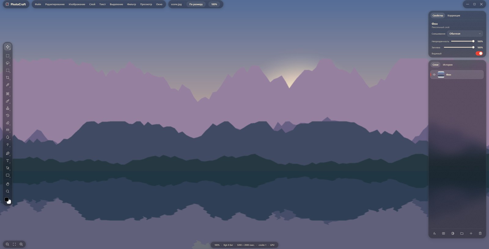
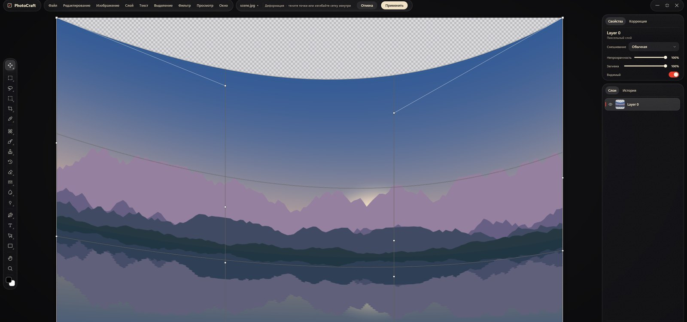

<h1 align="center">PhotoCraft by Vetro</h1>

<p align="center">
  <b>An unofficial fork of <a href="https://github.com/storytold/photocraft">PhotoCraft</a> with a new native Windows shell.</b><br>
  The PhotoCraft engine (Rust) is unchanged; the interface is rewritten in C++ on Direct3D 11, Direct2D and DirectComposition:<br>
  floating glass docks, physical motion, Phosphor icons and Photoshop-style interaction.
</p>

<p align="center">
  
  
  
  
</p>

<p align="center">
  
</p>

The original PhotoCraft README is kept as [README.photocraft.md](README.photocraft.md).

## How it differs from PhotoCraft

| | PhotoCraft (original) | PhotoCraft by Vetro |
|---|---|---|
| Interface | egui / eframe on wgpu (immediate mode), one codebase for macOS, Windows, Linux and the web | A native C++ shell for Windows: Direct3D 11 → Direct2D 1.1 → DirectComposition, with its own retained widget classes |
| Look | A classic Photoshop-like layout with docked panels | The Vetro style: the photo is the backdrop of the whole window, surrounded by floating frosted-glass docks (live blur of the scene, tint, grain, rim light, shadow), Phosphor icons, spring motion, menus that grow out of their button |
| Engine | `crates/*`: layers, brushes, PSD, filters, history, 890+ commands | The same engine, unchanged (in sync with the original's `main` as of 2026-10-13) |
| Link to the engine | Direct Rust calls | A C ABI bridge, `crates/bridge` (`photocraft_bridge.dll`): commands by id, document snapshots, live brush strokes, the GPU canvas, the menu catalog and translations |
| Canvas | The wgpu compositor inside the egui window | The engine's own GPU compositor on Direct3D 12 draws into a texture shared with the shell's Direct3D 11 device; only changed areas are redrawn; a CPU path as fallback |
| Colour | The engine's colour management | The window's monitor ICC profile → the engine's canvas table → a Direct2D 3D LUT effect on the canvas |
| Responsiveness | — | Commands, dialog previews and saving run in the background; the interface stays live while the engine works |
| Languages | 20 languages | English and Russian, switched by clicking the logo; Russian comes from the original's catalog, the shell's own strings are translated separately |
| Platforms | macOS, Windows, Linux, FreeBSD, web | Windows 10/11 x64 only (the shell); the engine itself stays cross-platform |

Everything the original has is still here: the egui app (`apps/photocraft`), the CLI, the web build
and the MCP server build as before. Vetro only adds `crates/bridge` and `vetro/`.

## What's in 0.8.2-v01

**Shell and style**
- Floating, draggable docks: brand and menus, tool options, the toolbar with flyout groups,
  Properties / Adjustments, Layers / History, the status capsule, zoom.
- One frosted-glass recipe everywhere; springs on everything that moves; menus that morph out of
  their button with a cascade of rows; Reduce Motion collapses the animation.
- Interaction classes instead of one-off drawing code: buttons, slider, toggle, segmented control,
  dropdown list, menu with submenus, tabs, dock, toast, tooltip, colour field, curve editor, and
  dialogs generated from each command's parameter description.

**Canvas**
- The engine's GPU compositor through a shared D3D12 ↔ D3D11 texture, updated by damage; a CPU
  path with detail levels for very large documents.
- Colour management by monitor profile; pan and zoom on springs.

**Tools** (all driven by engine commands)
- Brush, Pencil and Eraser with live engine strokes; smoothing; Alt+wheel and Alt+right-drag set
  size and hardness.
- Retouching: Spot Healing and Healing Brush, Clone Stamp (Alt sets the source, Aligned), Remove,
  Blur, Sharpen, Smudge, Dodge, Burn, Sponge and more.
- Selections: Rectangular and Elliptical Marquee, Lasso, Magnetic Lasso, Quick Selection, Magic
  Wand, Object Selection, with add and subtract modes.
- Crop and Perspective Crop; Pen, Freeform Pen and Curvature Pen; Path and Direct Selection; path
  actions in the right-click menu.
- Shapes: Rectangle, Rounded Rectangle, Ellipse, Triangle, Polygon, Star, Line.
- Horizontal and Vertical Type, Gradient, Paint Bucket, Eyedropper (with its own cursor), Color
  Sampler, Ruler, Note, Count, Artboard.

**Editors and dialogs**
- Free Transform: scale, rotate, distort and a Bézier-patch Warp, previewed live by the engine,
  with Ctrl+Z step by step.
- Camera Raw (tabs, HSL, color grading, point curve), Curves with points, Liquify (on-canvas tools,
  freeze mask), Layer Style, and every engine filter and adjustment as a dialog with live preview.

**Layers**
- Right-click menu, double-click (name: rename; row: layer style), Alt-click between layers for a
  clipping mask, drag to reorder (Alt: copy), visibility, blend modes, opacity.

**Menus and files**
- Photoshop's full menu from the engine's catalog, with availability and shortcuts.
- Open and save (PSD, PNG, JPEG, TIFF, WebP, `.pcraft` and the engine's other formats), system
  dialogs, file drop.
- Context menus on the canvas, for the pen, Free Transform and layers.

The details, with what was verified live, are in [vetro/PLAN.md](vetro/PLAN.md).

<p align="center">
  
</p>

## Architecture

```
VetroView — C++          vetro/shell      window, docks, widgets, tools, motion, glass
      ↑↓ C ABI           crates/bridge    photocraft_bridge.dll: commands, snapshots, strokes, GPU canvas
PhotoCraft Engine — Rust crates/*         layers, brushes, PSD, filters, history (unchanged)
      ↓
GPU: Direct3D 11 + Direct2D + DirectComposition (shell), wgpu on Direct3D 12 (canvas)
```

## Build and run

You need Rust (stable) and Visual Studio 2022 with the "Desktop development with C++" workload
(x64); CMake and Ninja come with Visual Studio.

```powershell
vetro\build.ps1 -Run -Open "C:\path\to\photo.jpg"
```

The result is `vetro\dist\PhotoCraftVetro.exe` next to `photocraft_bridge.dll`. A ready build is
on the [Releases](https://github.com/Phnem/photocraft-by-Vetro/releases) page.

## Roadmap

### 1. Photoshop parity in the shell

The engine already does almost everything the interface still lacks, so this is mostly shell work.
The gaps are listed in [vetro/PS_GAPS.md](vetro/PS_GAPS.md) and planned as tickets VT-24…VT-68 in
[vetro/TICKETS.md](vetro/TICKETS.md):

1. **Keys and gestures:** arrow-key nudges, Alt-drag copies with Move, number keys for opacity,
   Shift+[ ] for hardness, point-by-point Polygonal Lasso, Layers panel details.
2. **The system:** the Windows clipboard, dropping a file in as a layer, document tabs, recent
   files.
3. **Options bar and Free Transform:** transform menu and numeric fields, reference point, options
   for shapes, selections, Eyedropper, Gradient, Crop and Pen.
4. **Brushes, layers, adjustments:** the brush picker on right-click, the Brushes and Brush Settings
   panels, adjustment layer properties, masks, locks, effects under each layer, smart filters.
5. **Type:** on-canvas editing, fonts, the Character and Paragraph panels.
6. **Rulers, guides, grid and snapping.**
7. **Panels:** a Photoshop-style colour picker, Color, Swatches, Channels, Paths, History with
   snapshots, Navigator, Histogram, Info.
8. **Workspaces:** Select and Mask, Quick Mask, screen modes, the contextual task bar, New Document
   and Export As.

### 2. AI experiments

The plan is in [vetro/AI_PLAN.md](vetro/AI_PLAN.md) (in Russian). A hybrid: local models (ONNX
Runtime on the GPU) for precise masks and retouching, OpenRouter for scene understanding and
generation. AI results are ordinary layers, masks and selections, all non-destructive.

- **Smart selection with suggestions:** people, sky, water, horizon in one click (SAM 2.1).
- **Background and object removal:** BiRefNet, LaMa.
- **Generative replace and expand:** image models through OpenRouter, composited only inside the
  mask, with colour matching.
- **Portrait retouching:** face detection and parsing, skin smoothing that keeps texture.
- **Old photo restoration:** scratches, noise, faces, colorization, upscaling.
- **Text commands** ("make it warmer and lift the shadows"): an LLM plans a sequence of engine
  commands.

### 3. The rest of the engine

The engine has more than 890 commands. The menus already reach all of them; on-canvas and panel
interaction comes one feature at a time. Next after parity: Puppet Warp and Perspective Warp on
the canvas, the Filter Gallery, animation and video layers, slices and asset export, colour lookup
and soft proofing, painting symmetry, tool presets, actions and batch processing, WebAssembly
plug-ins.

## Documents

| File | What it covers |
|---|---|
| [vetro/PLAN.md](vetro/PLAN.md) | What is done: tickets VT-1…VT-23 and what was verified live |
| [vetro/TICKETS.md](vetro/TICKETS.md) | Tickets VT-24…VT-68 with the engine commands they build on and estimates |
| [vetro/PS_GAPS.md](vetro/PS_GAPS.md) | What is still missing compared with Photoshop 2026 |
| [vetro/AI_PLAN.md](vetro/AI_PLAN.md) | How to bring in AI features |
| [README.photocraft.md](README.photocraft.md) | The original PhotoCraft README (engine, egui app, CLI, MCP) |
| [AGENTS.md](AGENTS.md), [docs/](docs/) | The engine's rules and documentation, from the original |

The documents in `vetro/` are written in Russian.

## License and credits

- PhotoCraft — © the PhotoCraft authors ([storytold/photocraft](https://github.com/storytold/photocraft)),
  MIT OR Apache-2.0. This fork is distributed under the same terms
  ([LICENSE-MIT](LICENSE-MIT), [LICENSE-APACHE](LICENSE-APACHE), [NOTICE](NOTICE)).
- Icons — [Phosphor Icons](https://phosphoricons.com/), MIT
  ([vetro/shell/third_party/phosphor/LICENSE](vetro/shell/third_party/phosphor/LICENSE)); the
  missing ones are drawn on the same grid.
- PhotoCraft by Vetro is an unofficial fork and is not affiliated with the PhotoCraft or ArtCraft
  teams. The ArtCraft names and marks belong to them and are not used in this fork.
- Photoshop is a trademark of Adobe; it is mentioned only to compare behaviour.
